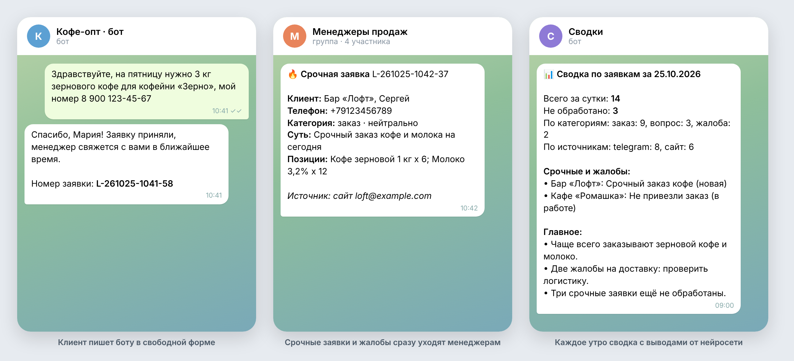
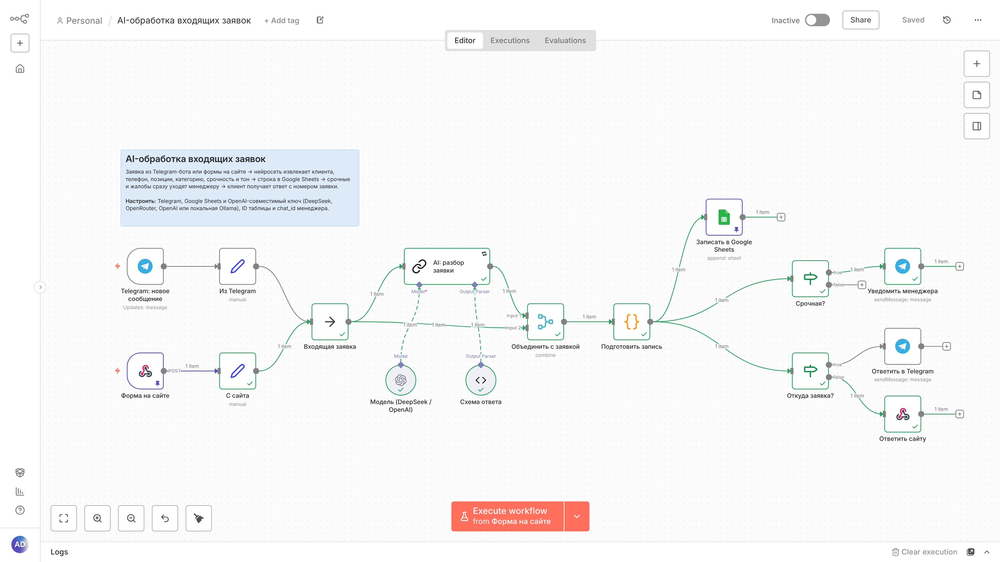
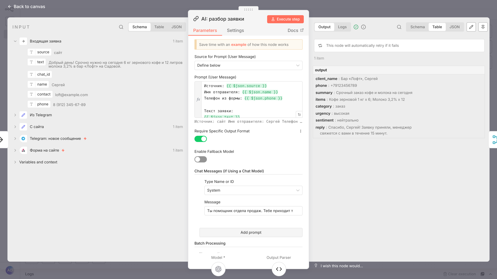
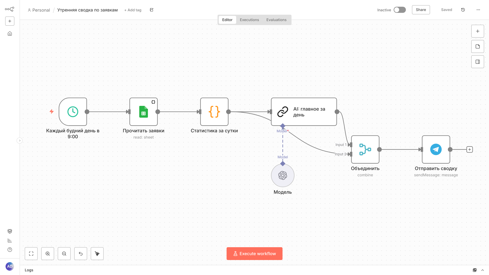

# AI-обработка входящих заявок на n8n

Набор сценариев n8n, который превращает заявки в свободной форме в аккуратную таблицу и не даёт срочным заказам потеряться.

Клиент пишет в Telegram-бота или отправляет форму на сайте как ему удобно: «срочно на сегодня 6 кг кофе и молоко в бар Лофт». Нейросеть вытаскивает из текста клиента, телефон, позиции, категорию, срочность и тон. Строка падает в Google Sheets, срочные заявки и жалобы сразу прилетают менеджерам в Telegram, клиент получает ответ с номером заявки. Каждое утро руководитель получает сводку за сутки с выводами от нейросети.



## Что внутри

| Сценарий | Что делает |
|---|---|
| `01_ai_lead_intake.json` | Приём заявок из Telegram и с сайта, разбор нейросетью, запись в Google Sheets, уведомление менеджеру, ответ клиенту |
| `02_daily_digest.json` | По будням в 9:00 читает таблицу, считает статистику за сутки, просит нейросеть выделить главное и отправляет сводку |
| `03_error_alerts.json` | Если любой сценарий упал, присылает администратору в Telegram узел, текст ошибки и ссылку на запуск |



## Как это устроено

1. **Два входа.** Telegram Trigger и Webhook для формы на сайте. Каждый вход приводится к одному формату (`source`, `text`, `name`, `phone`, `contact`, `chat_id`), поэтому дальше работает одна общая цепочка.
2. **Разбор нейросетью.** Узел Basic LLM Chain со строгой схемой ответа (Structured Output Parser). Модель подключается через OpenAI-совместимый API, так что подходит DeepSeek, OpenRouter, OpenAI или локальная Ollama. В промпте прямо запрещено придумывать то, чего нет в тексте. У узла включены повторы при сбое.
3. **Проверка результата кодом.** Нейросети не доверяем вслепую. Узел Code нормализует телефон к `+7XXXXXXXXXX` (а если модель телефон не нашла, ищет его регуляркой в тексте), проверяет, что категория, срочность и тон из разрешённого списка, присваивает номер заявки и экранирует пользовательский текст перед отправкой в Telegram.
4. **Google Sheets** как простая CRM: менеджеры меняют статус прямо в таблице.
5. **Маршрутизация.** Срочные заявки и любые жалобы уходят в группу менеджеров. Ответ клиенту приходит туда, откуда пришла заявка: в Telegram или в ответ на запрос формы.
6. **Утренняя сводка** считает цифры кодом, а нейросеть только формулирует выводы. Так числа в сводке всегда точные.
7. **Обработчик ошибок** подключён ко всем сценариям через Error Workflow.





## Запуск

Нужен Docker.

```bash
cp .env.example .env        # заполните WEBHOOK_URL и N8N_ENCRYPTION_KEY
docker compose up -d
```

Откройте http://localhost:5678, создайте аккаунт и импортируйте сценарии: **Workflows → Import from File**, по очереди три файла из папки `workflows/`. Или из контейнера:

```bash
docker compose exec n8n n8n import:workflow --separate --input=/workflows
```

Telegram-триггеру нужен публичный https-адрес. Для локальной проверки поднимите туннель (`ngrok http 5678`) и укажите его в `WEBHOOK_URL`.

### Настройка

1. **Google Sheets.** Создайте таблицу, назовите лист `Заявки` и вставьте в первую строку заголовки из `examples/google_sheet_header.csv`. ID таблицы из её адреса вставьте в узлы «Записать в Google Sheets» и «Прочитать заявки».
2. **Telegram.** Создайте бота у @BotFather и добавьте токен как учётные данные Telegram. Добавьте бота в группу менеджеров и укажите её `chat_id` в узлах «Уведомить менеджера» и «Отправить сводку», а свой `chat_id` в сценарии ошибок.
3. **Нейросеть.** Добавьте учётные данные OpenAI и в поле Base URL укажите адрес провайдера:

   | Провайдер | Base URL | Модель |
   |---|---|---|
   | DeepSeek | `https://api.deepseek.com/v1` | `deepseek-chat` |
   | OpenRouter | `https://openrouter.ai/api/v1` | например `deepseek/deepseek-chat` |
   | OpenAI | по умолчанию | `gpt-4o-mini` |
   | Ollama на своём сервере | `http://ollama:11434/v1` | например `qwen2.5:7b` |

   Если данные клиентов не должны уходить наружу, используйте Ollama: модель будет работать на вашем сервере.
4. В настройках сценариев 01 и 02 выберите **Error Workflow → «Уведомления об ошибках»** и включите все три сценария.

### Проверка

```bash
./examples/test_request.sh https://your-domain.example.com/webhook/lead
```

Ответ:

```json
{"ok":true,"id":"L-261025-104237-37","message":"Спасибо, Сергей! Заявку приняли, менеджер свяжется с вами в течение 15 минут."}
```

Пример формы для сайта лежит в `examples/site_form.html`.

## Что можно доработать

- Голосовые сообщения: расшифровка через Whisper перед разбором.
- Сверка позиций с каталогом товаров и остатками.
- Замена Google Sheets на CRM (amoCRM, Битрикс24) через их API.
- Напоминание менеджеру, если заявка висит в статусе «новая» дольше часа.

## Стек

n8n · LangChain-узлы n8n (Basic LLM Chain, Structured Output Parser) · OpenAI-совместимый API · Telegram Bot API · Google Sheets API · JavaScript (Code) · Docker

Сценарии проверены на n8n 1.123: все ветки прогнаны на тестовых заявках с подменённым API нейросети и Telegram.
